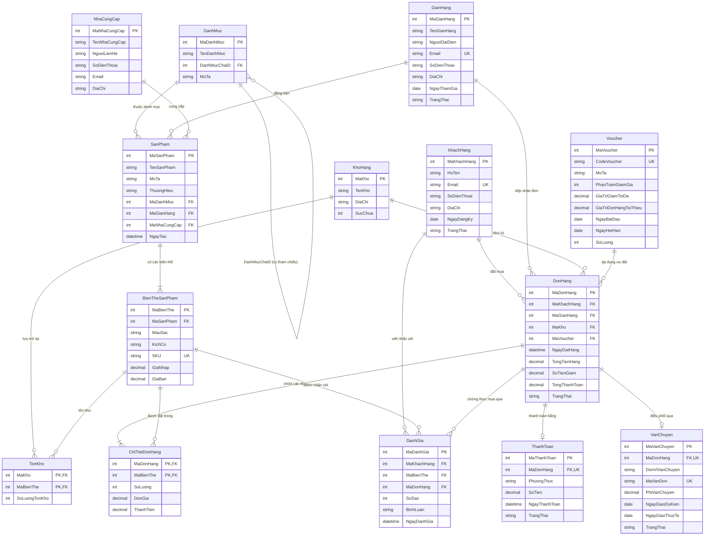

# BÁO CÁO THIẾT KẾ CƠ SỞ DỮ LIỆU
## ĐỀ TÀI: SÀN THƯƠNG MẠI ĐIỆN TỬ ĐA KÊNH & KHO THÔNG MINH
### HỆ QUẢN TRỊ CƠ SỞ DỮ LIỆU: MYSQL 8.0+ / ENGINE INNODB

---

## 1. PHÂN TÍCH NGHIỆP VỤ & MÔ HÌNH HÓA THỰC THỂ

### 1.1. Mô tả Tổng quan Nghiệp vụ Hệ thống
Hệ thống **Sàn Thương mại Điện tử Đa kênh & Kho Thông minh (Omnichannel E-commerce & Smart Warehouse)** vận hành mô hình B2C/C2C đa đối tác, kết nối giữa Người mua (Khách hàng), Người bán (Gian hàng/Seller), Nhà cung cấp hàng hóa (Supplier), Đơn vị Vận chuyển (Logistics) và Hệ thống Quản trị Kho hàng Đa điểm (Multi-Warehouse Management).

Quy trình nghiệp vụ cốt lõi bao gồm:
1. **Quản lý danh mục & phân cấp hàng hóa:** Hỗ trợ cây danh mục đa cấp (Danh mục cha - con tự tham chiếu) giúp người dùng dễ dàng tìm kiếm và điều hướng theo phân nhánh sản phẩm.
2. **Quản lý Sản phẩm & Biến thể SKU:** Tách bạch giữa thông tin sản phẩm dùng chung (Tên, Thương hiệu, Mô tả, Danh mục, Gian hàng, Nhà cung cấp) và các biến thể thương phẩm (Màu sắc, Kích cỡ, Mã đơn vị lưu kho SKU, Giá nhập, Giá bán niêm yết).
3. **Mô hình Kho đa điểm & Kiểm soát Tồn kho:** Quản lý nhiều kho bãi vật lý tại các vị trí địa lý khác nhau. Một biến thể sản phẩm có thể được phân bổ số lượng lưu trữ tại nhiều kho. Trạng thái tồn kho được cập nhật tức thời khi đơn hàng được xác nhận hoặc hủy.
4. **Vòng đời Đơn hàng & Xử lý Khuyến mãi:** Khách hàng chọn nhiều biến thể từ các gian hàng, áp dụng Voucher khuyến mãi (kiểm tra điều kiện đơn hàng tối thiểu và hạn sử dụng). Đơn hàng chuyển trạng thái tuần tự: `ChoXacNhan` -> `DaXacNhan` -> `DangGiao` -> `DaGiao` hoặc `Cancelled`.
5. **Thanh toán & Vận chuyển Đa kênh:** Mỗi đơn hàng liên kết giao dịch thanh toán (COD, Ví điện tử, Thẻ tín dụng) và mã vận đơn logistics chuyên biệt.
6. **Đánh giá & Phản hồi Khách hàng:** Khách hàng chỉ được phép đánh giá sản phẩm (1-5 sao kèm bình luận) sau khi đơn hàng chứa biến thể đó đã được giao thành công (`DaGiao`).

---

### 1.2. Danh sách Thực thể, Thuộc tính và Ràng buộc Khóa

#### 1. Thực thể `DanhMuc` (Danh mục sản phẩm phân cấp)
- **Mục đích:** Quản trị cấu trúc cây danh mục hàng hóa (ví dụ: Điện thoại & Thiết bị di động -> Điện thoại thông minh).
- **Thuộc tính:**
  - `MaDanhMuc` (INT, PK, AUTO_INCREMENT): Mã định danh danh mục.
  - `TenDanhMuc` (VARCHAR(100), NOT NULL): Tên danh mục.
  - `DanhMucChaID` (INT, NULL, FK trỏ về `DanhMuc.MaDanhMuc`): Mã danh mục cấp trên (NULL nếu là danh mục gốc cấp 1).
  - `MoTa` (TEXT): Mô tả chi tiết ngành hàng.
- **Bản số mối quan hệ:** `DanhMuc(Cha)` (1) --- (0..n) `DanhMuc(Con)` (Tự tham chiếu).

#### 2. Thực thể `GianHang` (Người bán / Shop đối tác)
- **Mục đích:** Lưu trữ thông tin nhà bán lẻ hoạt động trên nền tảng sàn thương mại điện tử.
- **Thuộc tính:**
  - `MaGianHang` (INT, PK, AUTO_INCREMENT): Mã định danh gian hàng.
  - `TenGianHang` (VARCHAR(150), NOT NULL): Tên thương hiệu gian hàng.
  - `NguoiDaiDien` (VARCHAR(100), NOT NULL): Họ tên người đại diện pháp luật.
  - `Email` (VARCHAR(100), NOT NULL, UNIQUE): Email liên hệ gian hàng.
  - `SoDienThoai` (VARCHAR(20), NOT NULL): Số điện thoại hotline gian hàng.
  - `DiaChi` (VARCHAR(255), NOT NULL): Địa chỉ đặt trụ sở/kho riêng của gian hàng.
  - `NgayThamGia` (DATE, NOT NULL): Ngày đăng ký mở gian hàng.
  - `TrangThai` (VARCHAR(30), NOT NULL, DEFAULT 'Active'): Trạng thái hoạt động (`Active`, `Suspended`, `Closed`).
- **Bản số mối quan hệ:** `GianHang` (1) --- (0..n) `SanPham`, `GianHang` (1) --- (0..n) `DonHang`.

#### 3. Thực thể `NhaCungCap` (Nhà sản xuất / Nhà phân phối nguồn hàng)
- **Mục đích:** Theo dõi nguồn gốc xuất xứ hàng hóa nhập khẩu hoặc phân phối chính hãng.
- **Thuộc tính:**
  - `MaNhaCungCap` (INT, PK, AUTO_INCREMENT): Mã nhà cung cấp.
  - `TenNhaCungCap` (VARCHAR(150), NOT NULL): Tên công ty cung cấp hàng hóa.
  - `NguoiLienHe` (VARCHAR(100), NOT NULL): Người đầu mối giao dịch.
  - `SoDienThoai` (VARCHAR(20), NOT NULL): Số điện thoại liên hệ.
  - `Email` (VARCHAR(100), NOT NULL): Hộp thư điện tử doanh nghiệp.
  - `DiaChi` (VARCHAR(255), NOT NULL): Trụ sở nhà phân phối.
- **Bản số mối quan hệ:** `NhaCungCap` (1) --- (0..n) `SanPham`.

#### 4. Thực thể `KhoHang` (Kho lưu trữ thông minh đa điểm)
- **Mục đích:** Quản trị các trung tâm xử lý đơn hàng (Fulfillment Centers) và kho vệ tinh.
- **Thuộc tính:**
  - `MaKho` (INT, PK, AUTO_INCREMENT): Mã kho bãi.
  - `TenKho` (VARCHAR(150), NOT NULL): Tên gọi trung tâm kho vận.
  - `DiaChi` (VARCHAR(255), NOT NULL): Địa chỉ tọa lạc kho.
  - `SucChua` (INT, NOT NULL): Sức chứa tối đa (đơn vị kiện hàng hoặc mét khối).
- **Bản số mối quan hệ:** `KhoHang` (1) --- (0..n) `TonKho`, `KhoHang` (1) --- (0..n) `DonHang`.

#### 5. Thực thể `SanPham` (Thông tin sản phẩm chung)
- **Mục đích:** Đại diện cho mặt hàng tổng quát trước khi phân tách theo màu sắc, quy cách đóng gói.
- **Thuộc tính:**
  - `MaSanPham` (INT, PK, AUTO_INCREMENT): Mã định danh sản phẩm.
  - `TenSanPham` (VARCHAR(200), NOT NULL): Tên gọi thương mại của sản phẩm.
  - `MoTa` (TEXT): Thông số kỹ thuật, bài viết mô tả sản phẩm.
  - `ThuongHieu` (VARCHAR(100), NOT NULL): Tên nhãn hàng (Apple, Samsung, Sony,...).
  - `MaDanhMuc` (INT, NOT NULL, FK trỏ về `DanhMuc.MaDanhMuc`): Phân loại danh mục.
  - `MaGianHang` (INT, NOT NULL, FK trỏ về `GianHang.MaGianHang`): Gian hàng sở hữu quyền bán.
  - `MaNhaCungCap` (INT, NOT NULL, FK trỏ về `NhaCungCap.MaNhaCungCap`): Đơn vị nhập khẩu/phân phối.
  - `NgayTao` (DATETIME, NOT NULL, DEFAULT CURRENT_TIMESTAMP): Thời điểm niêm yết lên sàn.
- **Bản số mối quan hệ:** `SanPham` (1) --- (1..n) `BienTheSanPham`.

#### 6. Thực thể `BienTheSanPham` (Quy cách thương phẩm & Đơn vị SKU)
- **Mục đích:** Lưu trữ phiên bản cụ thể của sản phẩm có thể giao dịch và kiểm đếm thực tế.
- **Thuộc tính:**
  - `MaBienThe` (INT, PK, AUTO_INCREMENT): Mã biến thể duy nhất.
  - `MaSanPham` (INT, NOT NULL, FK trỏ về `SanPham.MaSanPham`): Thuộc sản phẩm cha nào.
  - `MauSac` (VARCHAR(50), NOT NULL): Thuộc tính màu sắc (Xanh, Đen, Trắng,...).
  - `KichCo` (VARCHAR(50), NOT NULL): Kích cỡ / Dung lượng (128GB, 256GB, XL, M,...).
  - `SKU` (VARCHAR(50), NOT NULL, UNIQUE): Mã quản lý lưu kho duy nhất toàn hệ thống.
  - `GiaNhap` (DECIMAL(15, 2), NOT NULL): Đơn giá vốn nhập kho.
  - `GiaBan` (DECIMAL(15, 2), NOT NULL): Giá bán lẻ niêm yết cho khách hàng.
- **Ràng buộc:** `CHECK (GiaBan > GiaNhap)`.
- **Bản số mối quan hệ:** `BienTheSanPham` (1) --- (0..n) `TonKho`, `BienTheSanPham` (1) --- (0..n) `ChiTietDonHang`, `BienTheSanPham` (1) --- (0..n) `DanhGia`.

#### 7. Thực thể `TonKho` (Thực thể kết hợp Kho hàng - Biến thể sản phẩm)
- **Mục đích:** Quản lý số lượng hiện có của từng biến thể tại từng kho hàng cụ thể.
- **Thuộc tính:**
  - `MaKho` (INT, NOT NULL, FK trỏ về `KhoHang.MaKho`): Mã kho hàng.
  - `MaBienThe` (INT, NOT NULL, FK trỏ về `BienTheSanPham.MaBienThe`): Mã biến thể sản phẩm.
  - `SoLuongTonKho` (INT, NOT NULL, DEFAULT 0): Số lượng khả dụng trong kho.
- **Khóa chính tổ hợp:** `PRIMARY KEY (MaKho, MaBienThe)`.
- **Ràng buộc:** `CHECK (SoLuongTonKho >= 0)`.

#### 8. Thực thể `KhachHang` (Người tiêu dùng)
- **Mục đích:** Lưu trữ hồ sơ tài khoản người mua sắm.
- **Thuộc tính:**
  - `MaKhachHang` (INT, PK, AUTO_INCREMENT): Mã khách hàng.
  - `HoTen` (VARCHAR(100), NOT NULL): Họ và tên đầy đủ.
  - `Email` (VARCHAR(100), NOT NULL, UNIQUE): Thư điện tử đăng nhập.
  - `SoDienThoai` (VARCHAR(20), NOT NULL): Số điện thoại liên hệ nhận hàng.
  - `DiaChi` (VARCHAR(255), NOT NULL): Địa chỉ mặc định.
  - `NgayDangKy` (DATE, NOT NULL): Ngày tạo tài khoản.
  - `TrangThai` (VARCHAR(30), NOT NULL, DEFAULT 'Active'): Trạng thái tài khoản (`Active`, `Locked`).
- **Bản số mối quan hệ:** `KhachHang` (1) --- (0..n) `DonHang`, `KhachHang` (1) --- (0..n) `DanhGia`.

#### 9. Thực thể `Voucher` (Phiếu giảm giá / Mã khuyến mãi)
- **Mục đích:** Quản lý các chiến dịch giảm giá sàn hoặc mã khuyến mãi của chương trình.
- **Thuộc tính:**
  - `MaVoucher` (INT, PK, AUTO_INCREMENT): Mã định danh voucher.
  - `CodeVoucher` (VARCHAR(50), NOT NULL, UNIQUE): Mã ký tự nhập giảm giá (ví dụ: `SIEUSALE10`, `TECH2026`).
  - `MoTa` (VARCHAR(255)): Tên chương trình ưu đãi.
  - `PhanTramGiamGia` (INT, NOT NULL): Tỷ lệ chiết khấu (1% đến 100%).
  - `GiaTriGiamToiDa` (DECIMAL(15, 2), NOT NULL): Số tiền giảm tối đa của voucher.
  - `GiaTriDonHangToiThieu` (DECIMAL(15, 2), NOT NULL): Ngưỡng giá trị đơn hàng được phép áp dụng.
  - `NgayBatDau` (DATE, NOT NULL): Ngày bắt đầu chiến dịch.
  - `NgayHetHan` (DATE, NOT NULL): Ngày hết hiệu lực.
  - `SoLuong` (INT, NOT NULL, DEFAULT 100): Số lượt phát hành còn lại.
- **Ràng buộc:** `CHECK (PhanTramGiamGia BETWEEN 1 AND 100)`.
- **Bản số mối quan hệ:** `Voucher` (0..1) --- (0..n) `DonHang`.

#### 10. Thực thể `DonHang` (Hóa đơn đặt hàng)
- **Mục đích:** Đại diện cho giao dịch mua hàng hoàn chỉnh của khách hàng tại một gian hàng, xuất từ một kho.
- **Thuộc tính:**
  - `MaDonHang` (INT, PK, AUTO_INCREMENT): Mã số đơn hàng.
  - `MaKhachHang` (INT, NOT NULL, FK trỏ về `KhachHang.MaKhachHang`): Người mua.
  - `MaGianHang` (INT, NOT NULL, FK trỏ về `GianHang.MaGianHang`): Đơn vị bán hàng.
  - `MaKho` (INT, NOT NULL, FK trỏ về `KhoHang.MaKho`): Kho xử lý đóng gói và xuất kho.
  - `MaVoucher` (INT, NULL, FK trỏ về `Voucher.MaVoucher`): Mã khuyến mãi áp dụng.
  - `NgayDatHang` (DATETIME, NOT NULL): Thời gian xác lập đơn.
  - `TongTienHang` (DECIMAL(15, 2), NOT NULL): Tổng giá trị hàng hóa trước giảm giá.
  - `SoTienGiam` (DECIMAL(15, 2), NOT NULL, DEFAULT 0.00): Số tiền chiết khấu thực tế từ voucher.
  - `TongThanhToan` (DECIMAL(15, 2), NOT NULL): Số tiền thực tế người mua phải trả (`TongTienHang - SoTienGiam`).
  - `TrangThai` (VARCHAR(30), NOT NULL, DEFAULT 'ChoXacNhan'): Tiến độ xử lý đơn (`ChoXacNhan`, `DaXacNhan`, `DangGiao`, `DaGiao`, `Cancelled`).
- **Bản số mối quan hệ:** `DonHang` (1) --- (1..n) `ChiTietDonHang`, `DonHang` (1) --- (0..1) `ThanhToan`, `DonHang` (1) --- (0..1) `VanChuyen`.

#### 11. Thực thể `ChiTietDonHang` (Danh mục mặt hàng trong đơn)
- **Mục đích:** Lưu trữ chi tiết từng biến thể sản phẩm, số lượng và đơn giá chốt tại thời điểm đặt hàng.
- **Thuộc tính:**
  - `MaDonHang` (INT, NOT NULL, FK trỏ về `DonHang.MaDonHang`): Mã đơn hàng.
  - `MaBienThe` (INT, NOT NULL, FK trỏ về `BienTheSanPham.MaBienThe`): Mã biến thể sản phẩm.
  - `SoLuong` (INT, NOT NULL): Số lượng đặt mua.
  - `DonGia` (DECIMAL(15, 2), NOT NULL): Giá bán thực tế tại thời điểm chốt đơn.
  - `ThanhTien` (DECIMAL(15, 2), NOT NULL): Thành tiền (`SoLuong * DonGia`).
- **Khóa chính tổ hợp:** `PRIMARY KEY (MaDonHang, MaBienThe)`.
- **Ràng buộc:** `CHECK (SoLuong > 0)`.

#### 12. Thực thể `ThanhToan` (Giao dịch tài chính)
- **Mục đích:** Ghi nhận chứng từ giao dịch thanh toán của đơn hàng.
- **Thuộc tính:**
  - `MaThanhToan` (INT, PK, AUTO_INCREMENT): Mã chứng từ thanh toán.
  - `MaDonHang` (INT, NOT NULL, UNIQUE, FK trỏ về `DonHang.MaDonHang`): Đơn hàng tương ứng.
  - `PhuongThuc` (VARCHAR(50), NOT NULL): Kênh thanh toán (`COD`, `TheTinDung`, `ViDienTu`, `ChuyenKhoan`).
  - `SoTien` (DECIMAL(15, 2), NOT NULL): Số tiền thực thu.
  - `NgayThanhToan` (DATETIME, NOT NULL): Thời điểm giao dịch hoàn tất.
  - `TrangThai` (VARCHAR(30), NOT NULL): Trạng thái (`ThanhCong`, `DangXuLy`, `ThatBai`, `HoanTien`).

#### 13. Thực thể `VanChuyen` (Vận đơn giao nhận)
- **Mục đích:** Điều phối đơn vị vận chuyển bên thứ ba và theo dõi trạng thái giao hàng.
- **Thuộc tính:**
  - `MaVanChuyen` (INT, PK, AUTO_INCREMENT): Mã quản lý giao nhận.
  - `MaDonHang` (INT, NOT NULL, UNIQUE, FK trỏ về `DonHang.MaDonHang`): Đơn hàng liên kết.
  - `DonViVanChuyen` (VARCHAR(100), NOT NULL): Tên hãng giao nhận (SPX Express, GHTK, GHN, Viettel Post).
  - `MaVanDon` (VARCHAR(100), NOT NULL, UNIQUE): Mã tracking vận đơn đối tác.
  - `PhiVanChuyen` (DECIMAL(15, 2), NOT NULL, DEFAULT 0.00): Cước phí vận chuyển.
  - `NgayGiaoDuKien` (DATE, NOT NULL): Hạn chót dự kiến giao hàng.
  - `NgayGiaoThucTe` (DATE, NULL): Thời gian khách nhận hàng thành công.
  - `TrangThai` (VARCHAR(30), NOT NULL): Tiến độ (`DangLayHang`, `DangVanChuyen`, `DaGiaoHang`, `GiaoThatBai`).

#### 14. Thực thể `DanhGia` (Phản hồi & Đánh giá chất lượng)
- **Mục đích:** Tiếp nhận xếp hạng sao và bình luận của khách hàng về sản phẩm đã trải nghiệm.
- **Thuộc tính:**
  - `MaDanhGia` (INT, PK, AUTO_INCREMENT): Mã bản ghi đánh giá.
  - `MaKhachHang` (INT, NOT NULL, FK trỏ về `KhachHang.MaKhachHang`): Người đánh giá.
  - `MaBienThe` (INT, NOT NULL, FK trỏ về `BienTheSanPham.MaBienThe`): Biến thể được đánh giá.
  - `MaDonHang` (INT, NOT NULL, FK trỏ về `DonHang.MaDonHang`): Đơn hàng thực chứng đã mua sản phẩm.
  - `SoSao` (INT, NOT NULL): Mức độ hài lòng (1 đến 5 sao).
  - `BinhLuan` (TEXT): Ý kiến phản hồi chi tiết.
  - `NgayDanhGia` (DATETIME, NOT NULL, DEFAULT CURRENT_TIMESTAMP): Thời gian gửi đánh giá.
- **Ràng buộc:** `CHECK (SoSao BETWEEN 1 AND 5)`.

---

## 2. SƠ ĐỒ THỰC THỂ KẾT HỢP (E/R DIAGRAM - MERMAID)

Dưới đây là sơ đồ thực thể kết hợp hoàn chỉnh của hệ thống, chuẩn hóa bằng cú pháp Mermaid `erDiagram`, thể hiện đầy đủ khóa chính (PK), khóa ngoại (FK), khóa duy nhất (UK) và bản số mối quan hệ:

---

## 3. GIẢI TRÌNH QUÁ TRÌNH CHUẨN HÓA CƠ SỞ DỮ LIỆU ĐẠT CHUẨN 3NF

Quá trình chuẩn hóa cơ sở dữ liệu đóng vai trò quyết định giúp loại bỏ hiện tượng dư thừa dữ liệu (Data Redundancy), ngăn ngừa các dị thường dữ liệu (Insertion Anomaly, Update Anomaly, Deletion Anomaly), và tối ưu hóa hiệu năng truy vấn cho toàn bộ quy trình sàn thương mại điện tử.

### 3.1. Dạng chuẩn 1 (1NF - First Normal Form)
- **Định nghĩa 1NF:** Một quan hệ đạt 1NF nếu và chỉ nếu toàn bộ các thuộc tính đều có tính nguyên tử (Atomic values), không chứa nhóm lặp (Repeating groups), không chứa danh sách/mảng giá trị trong một ô dữ liệu.
- **Hiện trạng trước khi chuẩn hóa:**
  - Nếu gom chung thông tin biến thể vào sản phẩm: Ví dụ một dòng `SanPham` lưu cột `MauSac = 'Đen, Trắng, Titan'`, cột `KichCo = '128GB, 256GB, 512GB'`, cột `TonKho = 'Kho HN: 20, Kho HCM: 50'`. Điều này vi phạm nghiêm trọng 1NF.
  - Tương tự, nếu bảng `DonHang` lưu cột `DanhSachSanPham = 'IP15-256 (x1), SS24-512 (x2)'` thì không thể lập chỉ mục (index), tính tổng hay ràng buộc khóa ngoại.
- **Biện pháp xử lý đưa về 1NF:**
  - Tách các mảng giá trị thành các hàng riêng biệt.
  - Tách bảng `BienTheSanPham` riêng biệt, mỗi hàng chứa đúng một cặp `(MauSac, KichCo)` nguyên tử với mã `SKU` duy nhất.
  - Tách bảng trung gian `TonKho` với mỗi hàng lưu trữ đúng một cặp `(MaKho, MaBienThe)` kèm một giá trị nguyên tử `SoLuongTonKho`.
  - Tách các dòng mặt hàng trong đơn thành bảng `ChiTietDonHang`, mỗi dòng lưu đúng một cặp `(MaDonHang, MaBienThe)` kèm `SoLuong`, `DonGia` và `ThanhTien`.
- **Kết luận:** Toàn bộ 14 bảng trong lược đồ đều đạt 1NF vì mỗi trường dữ liệu chỉ chứa giá trị đơn lẻ, vô hướng, không lặp.

---

### 3.2. Dạng chuẩn 2 (2NF - Second Normal Form)
- **Định nghĩa 2NF:** Một quan hệ đạt 2NF nếu và chỉ nếu đã đạt 1NF và **mọi thuộc tính không khóa phải phụ thuộc hàm đầy đủ vào toàn bộ khóa chính**, nghĩa là không tồn tại phụ thuộc hàm bộ phận (Partial Dependency) vào một phần của khóa chính tổ hợp.
- **Kiểm tra các bảng có khóa chính đơn:**
  - Đối với các bảng có khóa chính gồm 1 thuộc tính duy nhất như `DanhMuc(MaDanhMuc)`, `GianHang(MaGianHang)`, `NhaCungCap(MaNhaCungCap)`, `KhoHang(MaKho)`, `SanPham(MaSanPham)`, `BienTheSanPham(MaBienThe)`, `KhachHang(MaKhachHang)`, `Voucher(MaVoucher)`, `DonHang(MaDonHang)`, `ThanhToan(MaThanhToan)`, `VanChuyen(MaVanChuyen)`, `DanhGia(MaDanhGia)`: Do khóa chính chỉ có 1 thuộc tính nên hiển nhiên không thể tồn tại phụ thuộc hàm bộ phận vào một phần của khóa. Do đó các bảng này mặc nhiên thỏa mãn 2NF.
- **Kiểm tra và xử lý các bảng có Khóa chính tổ hợp:**
  1. **Bảng `ChiTietDonHang`:**
     - Khóa chính: `(MaDonHang, MaBienThe)`.
     - Phụ thuộc hàm gốc:
       - `{MaDonHang, MaBienThe} -> SoLuong`
       - `{MaDonHang, MaBienThe} -> DonGia` (giá bán chốt tại thời điểm đặt hàng)
       - `{MaDonHang, MaBienThe} -> ThanhTien`
     - **Nguy cơ vi phạm 2NF:** Nếu đưa thuộc tính `TenSanPham`, `MauSac`, `KichCo`, `TenGianHang` hay `GiaBanHienTai` vào bảng `ChiTietDonHang`, ta sẽ có phụ thuộc bộ phận:
       - `MaBienThe -> {MauSac, KichCo, GiaBanHienTai}`
       - `MaBienThe -> MaSanPham -> TenSanPham`
       Những thuộc tính này chỉ phụ thuộc vào `MaBienThe` chứ không phụ thuộc vào `MaDonHang`.
     - **Giải pháp:** Tách hoàn toàn các thông tin thuộc tính biến thể sang bảng `BienTheSanPham` và `SanPham`. Bảng `ChiTietDonHang` chỉ lưu đúng các thuộc tính phụ thuộc vào cả cặp `(MaDonHang, MaBienThe)` là `SoLuong`, `DonGia` (lịch sử đơn giá giao dịch) và `ThanhTien`.
  2. **Bảng `TonKho`:**
     - Khóa chính: `(MaKho, MaBienThe)`.
     - Phụ thuộc hàm gốc:
       - `{MaKho, MaBienThe} -> SoLuongTonKho`
     - **Nguy cơ vi phạm 2NF:** Nếu lưu `TenKho`, `DiaChiKho`, `TenSanPham` trong bảng này thì `MaKho -> {TenKho, DiaChiKho}` là phụ thuộc hàm bộ phận vào một phần của khóa chính `(MaKho)`.
     - **Giải pháp:** Lưu `TenKho`, `DiaChiKho` tại bảng `KhoHang`. Bảng `TonKho` chỉ thuần túy lưu mối quan hệ lưu trữ giữa `MaKho` và `MaBienThe` kèm số lượng tồn.
- **Kết luận:** Toàn bộ các bảng đều đạt 2NF vì không tồn tại bất kỳ phụ thuộc hàm bộ phận nào vào khóa chính tổ hợp.

---

### 3.3. Dạng chuẩn 3 (3NF - Third Normal Form)
- **Định nghĩa 3NF:** Một quan hệ đạt 3NF nếu và chỉ nếu đã đạt 2NF và **mọi thuộc tính không khóa đều không phụ thuộc bắc cầu (Transitive Dependency) vào khóa chính**. Tức là không tồn tại chuỗi phụ thuộc: `X -> Y -> Z` (trong đó `X` là khóa chính, `Y` là thuộc tính không khóa, và `Z` phụ thuộc vào `Y`).
- **Phân tích và loại bỏ phụ thuộc bắc cầu:**
  1. **Bảng `SanPham` & `BienTheSanPham`:**
     - Giả sử trong `BienTheSanPham` lưu các cột: `MaBienThe (PK)`, `TenSanPham`, `ThuongHieu`, `TenDanhMuc`, `TenGianHang`, `TenNhaCungCap`.
     - Khi đó tồn tại các chuỗi phụ thuộc bắc cầu:
       - `MaBienThe -> MaSanPham -> {TenSanPham, ThuongHieu}`
       - `MaSanPham -> MaDanhMuc -> TenDanhMuc`
       - `MaSanPham -> MaGianHang -> TenGianHang`
       - `MaSanPham -> MaNhaCungCap -> TenNhaCungCap`
     - Nếu để như vậy, mỗi khi một sản phẩm có 5 biến thể (màu sắc/size), tên sản phẩm, thông tin gian hàng và tên nhà cung cấp bị nhân bản 5 lần. Khi gian hàng đổi tên, hệ thống phải cập nhật hàng ngàn dòng biến thể (Update Anomaly).
     - **Giải pháp:** Tách thành các bảng độc lập `DanhMuc`, `GianHang`, `NhaCungCap`, `SanPham` và `BienTheSanPham`. Bảng `SanPham` chỉ giữ các khóa ngoại `MaDanhMuc`, `MaGianHang`, `MaNhaCungCap`. Bảng `BienTheSanPham` chỉ giữ khóa ngoại `MaSanPham`.
  2. **Bảng `DonHang` & `KhachHang`:**
     - Trong bảng `DonHang`, khóa chính là `MaDonHang`.
     - Không lưu `HoTenKhachHang`, `EmailKhachHang`, `DiaChiKhachHang` trong `DonHang` vì sẽ tạo chuỗi: `MaDonHang -> MaKhachHang -> {HoTen, Email, DiaChi}`.
     - **Giải pháp:** `DonHang` chỉ lưu `MaKhachHang (FK)`. Khi cần xuất thông tin giao hàng, truy vấn thông qua phép nối `INNER JOIN` với `KhachHang`.
  3. **Bảng `DonHang` & `Voucher`:**
     - Trong bảng `DonHang`, khi áp dụng voucher, hệ thống chỉ tham chiếu qua `MaVoucher (FK)` và lưu giá trị tiền giảm thực tế `SoTienGiam` (chốt lịch sử số tiền giảm tại thời điểm thanh toán để phục vụ kế toán, đối soát), không lưu các thuộc tính điều kiện như `PhanTramGiamGia`, `GiaTriDonHangToiThieu`, `NgayHetHan` vào bảng `DonHang`.
  4. **Bảng `ThanhToan` & `VanChuyen`:**
     - Được tách riêng khỏi bảng `DonHang` thành 2 bảng thực thể chuyên biệt (quan hệ 1-1 với `DonHang` thông qua `MaDonHang UNIQUE FK`), giúp thông tin trạng thái vận đơn và trạng thái cổng thanh toán không làm cồng kềnh bản ghi đơn hàng, tránh phụ thuộc hàm bắc cầu và cho phép mở rộng quy trình hoàn tiền, tái giao hàng độc lập.
  5. **Bảng `DanhGia`:**
     - Khóa chính là `MaDanhGia`.
     - Chỉ lưu các khóa ngoại `MaKhachHang`, `MaBienThe`, `MaDonHang` cùng thuộc tính đánh giá `SoSao`, `BinhLuan`, `NgayDanhGia`. Không lưu các trường thông tin dư thừa của khách hàng hay sản phẩm.

- **Kết luận:** Tất cả 14 bảng trong lược đồ đều đạt **Chuẩn hóa 3NF (Third Normal Form)**, loại bỏ hoàn toàn dư thừa dữ liệu, đảm bảo tính toàn vẹn tham chiếu, tối ưu hóa không gian lưu trữ và đảm bảo hiệu năng tối đa cho hệ thống MySQL 8.0+.
